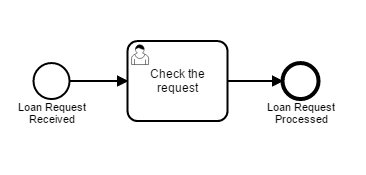
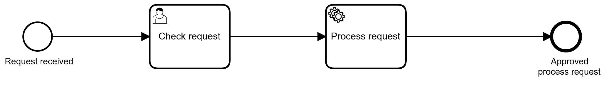
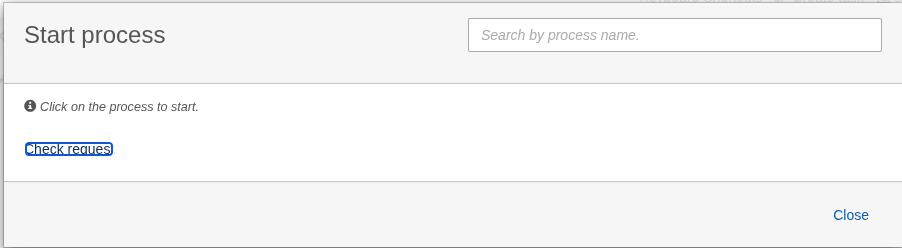
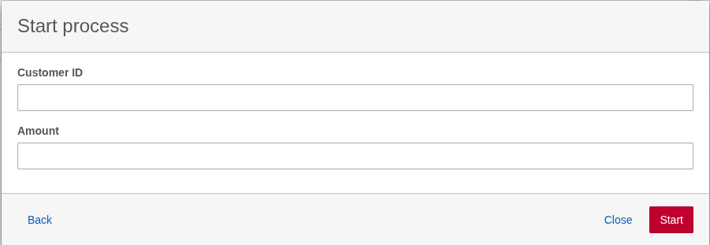
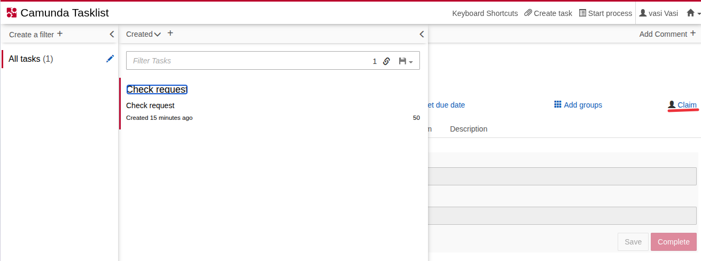
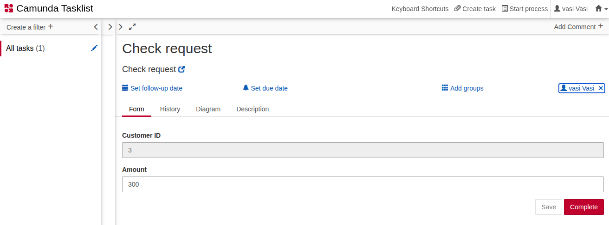
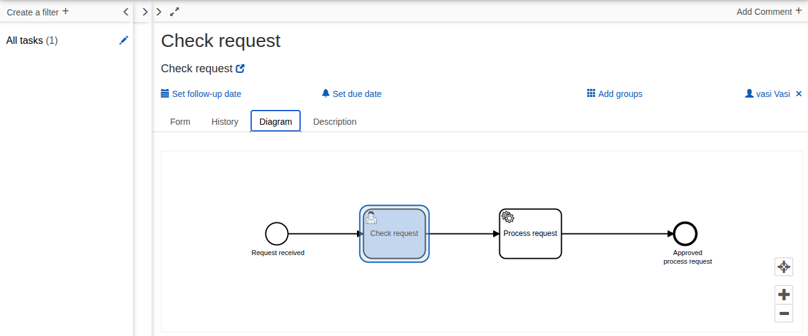
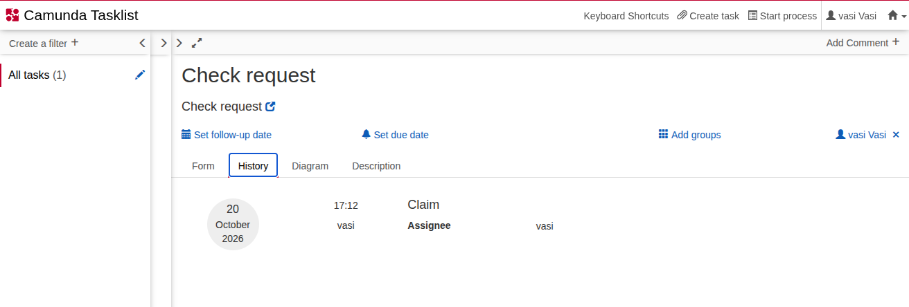
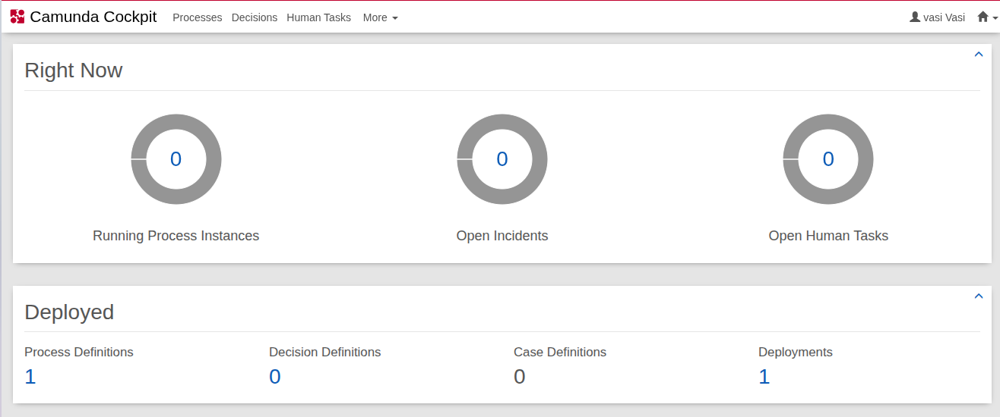

## Старт с Camunda и Spring Boot

[Источник](https://docs.camunda.org/get-started/spring-boot/)

Пример показывает запуск простейшего camunda-процесса.



```java
@EnableProcessApplication
@SpringBootApplication
public class SpringBootFirstApplication {

	@Autowired
	private RuntimeService runtimeService;

	public static void main(String[] args) {
		SpringApplication.run(SpringBootFirstApplication.class, args);
	}

	@EventListener
	private void processPostDeploy(PostDeployEvent event) {
		// "process_request" - ID процесса в modeler
		runtimeService.startProcessInstanceByKey("process_request");
	}

}

```
Запуск [./run.sh](run.sh):

````shell
/usr/lib/jvm/java-8-openjdk-amd64/bin/java -jar target/spring-boot-first-1.jar
````

После запуска, перейти по ссылке

[http://127.0.0.1:8080/app/welcome/default/#!/login](http://127.0.0.1:8080/app/welcome/default/#!/login)

Имя/пароль: vasi/pass см.[application.yaml](src/main/resources/application.yaml)

[http://127.0.0.1:8080/spring-boot-first-1](http://127.0.0.1:8080/spring-boot-first-1)

Добавлена обработка принятых параметров сервисом (делегатом) в виде метода java-класса



```java
public class ProcessRequestDelegate implements JavaDelegate {

  private final static Logger LOGGER = LoggerFactory.getLogger(ProcessRequestDelegate.class);

  public void execute(DelegateExecution execution) throws Exception {
    LOGGER.info("Processing request by '" + execution.getVariable("customerId") + "'...");
  }
}
```

### Тестовый пример

Для проверки развернут сервис по адресу [http://v.perm.ru:8080/spring-boot-first-1](http://v.perm.ru:8080/spring-boot-first-1)

Login: vasi
Password: pass

Перейти в *Task list*, выбрать в меню "Start Process"

### Camunda Cockpit

Cockpit это веб-интерфейс для просмотра и управления процессами.
Адрес: [http://localhost:8080/app/cockpit/default/#/dashboardhttp://localhost:8080/app/cockpit/default/#/dashboard](http://localhost:8080/app/cockpit/default/#/dashboard)

Последовательность работы с Cockpit: 

1. В Camunda Task list (в интерфейсе Cocpit) выбрать "Start Process":
   
2. В окне выбора процесса "Start Process" выбрать процесс "Check request":
   
3. Заполнить параметры (переменные) процесса:
   
   и нажать кнопку "Start"
4. Окно Cockpit после создания процесса: 
   
5. Для утверждения заявки в окне Cockpit нажать кнопку "Claim" 
6. Появится окно утверждения заявки:
   
   Тут же можно посмотреть граф процесса:
   
   History:
   
   Вернуться на вкладку "Form" и нажать кнопку "Complete". После этого процесс завершится. В панели "All Tasks" количество задач будет равно 0.
   Кроме того, в Cockpit можно увидеть, что нет активных процессов:
   